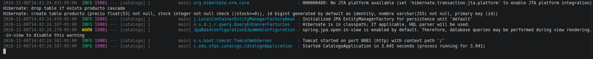
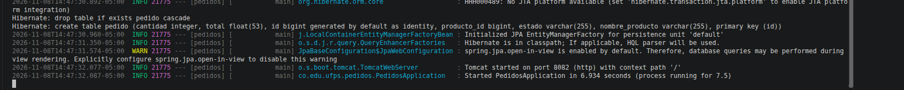
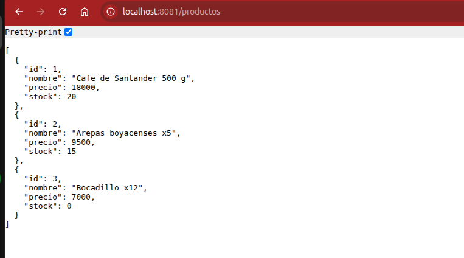
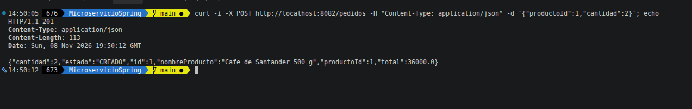
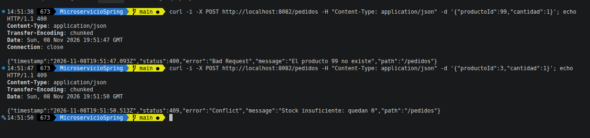
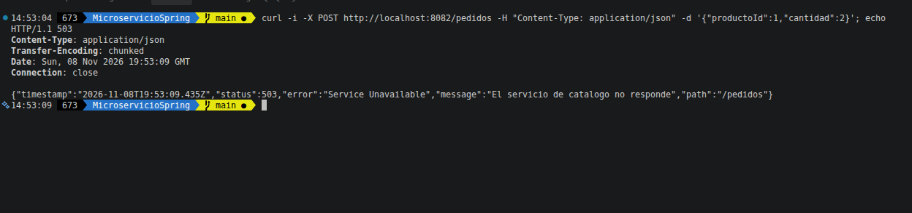
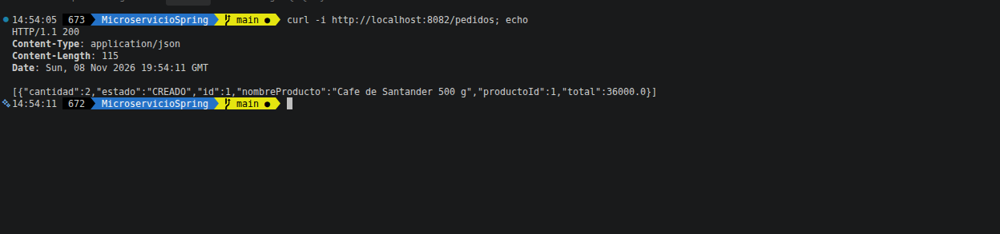

# Microservicios con Spring Boot: Catálogo y Pedidos

Laboratorio de la materia **Desarrollo de aplicaciones basadas en microservicios (UFPS)**.
Son dos microservicios independientes, cada uno con su propia base de datos H2 en memoria, que se comunican por HTTP.

| Servicio | Puerto | Base de datos | Responsabilidad |
|---|---|---|---|
| Catálogo | 8081 | `jdbc:h2:mem:catalogo` | CRUD de productos (nombre, precio, stock) |
| Pedidos | 8082 | `jdbc:h2:mem:pedidos` | Crea pedidos consultando a Catálogo por HTTP (`RestClient`) |

## Tecnologías

Java 25 · Spring Boot 4.1.2 · Spring Web · Spring Data JPA · H2 · Validation · Maven

## Cómo ejecutarlo

Cada servicio en su propia terminal:

```bash
cd catalogo && ./mvnw spring-boot:run
cd pedidos && ./mvnw spring-boot:run
```

## Endpoints

**Catálogo** (`http://localhost:8081`)
- `GET /productos` · `GET /productos/{id}` · `POST /productos` · `PUT /productos/{id}` · `DELETE /productos/{id}`

**Pedidos** (`http://localhost:8082`)
- `GET /pedidos` · `POST /pedidos` con `{"productoId":1,"cantidad":2}`

## Evidencias

### 1. Catálogo en ejecución (puerto 8081)


### 2. Pedidos en ejecución (puerto 8082)


### 3. Lista de productos en el navegador


### 4. Pedido creado (201) con total calculado con el precio de Catálogo


### 5. Producto inexistente (400) y sin stock (409)


### 6. Catálogo apagado: Pedidos responde 503


### 7. Pedidos sigue funcionando con Catálogo apagado (200)


## Preguntas del experimento

### 1. ¿Qué le pasa a Pedidos cuando Catálogo no está? ¿Se cae también?

No, Pedidos no se cae. Son dos procesos independientes, cada uno con su propia base de datos. Cuando Catálogo está apagado, la llamada HTTP de Pedidos falla con una `ResourceAccessException`, el controlador la captura y responde **503 Service Unavailable** con el mensaje "El servicio de catalogo no responde" (evidencia 6).

Pedidos sigue funcionando para todo lo que no depende de Catálogo: por ejemplo, `GET /pedidos` responde 200 con los pedidos ya guardados (evidencia 7). Lo que no puede hacer es crear pedidos nuevos, porque necesita a Catálogo para validar el producto, el precio y el stock. Es una **falla parcial**, no total.

### 2. ¿Qué pasaría si Catálogo no estuviera caído, sino muy lento?

Sería peor que si estuviera caído. Como la llamada es **síncrona**, el hilo de Pedidos que atiende la petición se queda bloqueado esperando la respuesta de Catálogo, y el cliente también se queda esperando. Si Catálogo está caído, el error llega de inmediato (conexión rechazada); si está lento, la espera puede ser muy larga, porque no configuramos un tiempo máximo (*timeout*).

Si llegan muchos pedidos a la vez, todos los hilos del servidor de Pedidos quedan ocupados esperando, y Pedidos deja de responder incluso a peticiones que no usan Catálogo, como `GET /pedidos`. La lentitud de un servicio termina tumbando al otro: eso se llama **falla en cascada**.

Para evitarlo se usan:
- **Timeouts** en el `RestClient`, para no esperar indefinidamente.
- **Circuit breaker** (por ejemplo, Resilience4j): si Catálogo falla o tarda mucho varias veces, se dejan de hacer llamadas por un tiempo y se responde de una vez con un error o un valor por defecto.
- **Reintentos limitados** y respuestas de respaldo (*fallback*).

### 3. Pedidos no descuenta el stock de Catálogo. ¿Quién debería hacerlo y qué pasa si falla después de guardar el pedido?

Lo debe hacer **Catálogo**, porque es el dueño de los datos del producto y del stock. Pedidos no debe tocar la base de datos de Catálogo: debe pedírselo por HTTP, por ejemplo con un endpoint como `PUT /productos/{id}/descontar`, y Catálogo valida y actualiza su propio stock.

Si el pedido se guarda y después falla el descuento, los datos quedan **inconsistentes**: hay un pedido "CREADO", pero el stock en Catálogo no bajó. Así se puede vender más de lo que hay (sobreventa). Esto pasa porque son dos bases de datos distintas y no existe una sola transacción que cubra las dos: no se puede hacer un *rollback* entre servicios.

Formas de manejarlo:
- **Guardar el pedido como "PENDIENTE"**, pedir el descuento a Catálogo y solo si sale bien cambiarlo a "CONFIRMADO".
- **Compensación (patrón Saga):** si un paso falla, se deshace lo anterior con una acción contraria, por ejemplo marcar el pedido como "CANCELADO" o devolver el stock.
- **Mensajería asíncrona** (eventos): Pedidos publica "pedido creado" y Catálogo descuenta cuando lo recibe, con reintentos hasta que se procese.